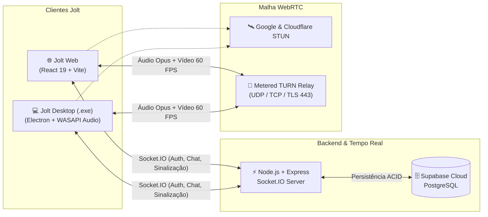

<div align="center">


# ⚡ Jolt

**Plataforma moderna de comunicação em tempo real: Voz Cristalina, Transmissão de Tela em até 1080p 60 FPS com Áudio Nativo e Salas de Cinema Sincronizadas.**

[](https://github.com/ErickSantana10/jolt/releases)
[](https://github.com/ErickSantana10/jolt/releases/latest/download/Jolt-Windows.exe)
[](https://webrtc.org/)
[](https://supabase.com/)
[](https://www.typescriptlang.org/)

[📥 **Baixar Jolt para Windows (.exe)**](https://github.com/ErickSantana10/jolt/releases/latest/download/Jolt-Windows.exe) • [🌐 **Acessar Versão Web**](https://jolt-ericksantana10.vercel.app)

</div>

---

## ✨ Visão Geral

O **Jolt** é uma aplicação completa de comunicação por voz, vídeo, chat e entretenimento sincronizado projetada para comunidades e grupos de amigos que buscam **baixa latência**, **qualidade de imagem de até 1080p 60 FPS** e uma **interface limpa em tons violeta/neon**.

Diferente de soluções convencionais, o **Jolt** funciona de forma híbrida e sincronizada entre o **Navegador Web** e o **Aplicativo Desktop Nativo para Windows (Electron)**, contando com captura de áudio de sistema via **WASAPI Loopback**, proteção inteligente **Anti-Eco**, seletor completo de dispositivos de entrada/saída e atualizador integrado em 1 clique.

---

## 🚀 Principais Funcionalidades

### 🎙️ 1. Voz de Baixa Latência & Painel de Áudio Avançado
- **Conexão P2P Híbrida (STUN + TURN Relay):** Atravessa qualquer NAT ou Firewall residencial utilizando servidores STUN (Google/Cloudflare) e servidores TURN (UDP/TCP 80 & 443).
- **Configurações Completas de Voz & Vídeo:**
  - Seleção em tempo real de **Microfone (Entrada)** e **Fone/Alto-falante (Saída)** via `setSinkId`.
  - Controle individual de volume de entrada (`0% - 200%`) e saída (`0% - 100%`).
  - **Testador de Microfone interativo** com medidor de barras em tempo real e retorno de áudio.
  - **Perfis de Áudio:** *Isolamento de Voz* (supressão de ruído + cancelamento de eco), *Estúdio* (áudio puro sem compressão) e *Personalizado*.
  - **Gate de Sensibilidade Automático ou Manual** com indicador visual de fala (anel verde neon).

### 🖥️ 2. Transmissão de Tela & Jogos em 60 FPS com Som Nativo
- **Seletor Nativo de Telas e Janelas (App Desktop):** Escolha qualquer monitor ou janela de jogo específica com miniaturas ao vivo.
- **Áudio do Sistema Cristalino + Anti-Eco Inteligente:** Captura o som do jogo/sistema via loopback nativo do Windows e atenua automaticamente a faixa de sistema no exato instante em que seus amigos falam na call, evitando que eles ouçam a própria voz duplicada.
- **3 Predefinições de Qualidade em Tempo Real:**
  - 🥔 **Modo Batata:** `480p @ 15 FPS` (Economia extrema de banda)
  - ⚖️ **Modo Equilibrado:** `720p @ 30 FPS` (Nitidez ideal para o dia a dia)
  - 🚀 **Modo Gamer:** `1080p @ 60 FPS` (Fluidez máxima com alto bitrate)
- **Palco Dedicado + Tela Cheia:** Layout fixo e simétrico que separa a tela transmitida (16:9) da barra inferior de participantes e permite expandir qualquer transmissão em **Tela Cheia** (botão dedicado ou duplo clique).

### 🎬 3. Salas de Cinema & DJ Sincronizadas (Watch Together)
- Assista a vídeos do **YouTube** ou ouça músicas em conjunto com todos na sala.
- **Sincronização Automática:** Play, Pause, Seek (avançar/voltar) e fila de reprodução sincronizados em tempo real via WebSockets (`media:heartbeat` + `media:sync-action`).
- **Sistema de Votação (Vote Skip):** Pule faixas democraticamente com os participantes da sala.

### 💬 4. Comunidades, Cargos, Mensagens Diretas & Chamadas Privadas
- **Servidores Personalizáveis:** Ícone, banner, descrição, código de convite instantâneo e envio de convites interativos via DM.
- **Sistema de Cargos e Moderação:** Criação de cargos coloridos com permissões administrativas, atribuição de tags, castigo temporário (*timeout*) e expulsão de membros.
- **Mensagens com Anexos:** Suporte a envio de imagens, GIFs e vídeos tanto nos canais de texto quanto nas conversas privadas (DMs).
- **Chamadas Diretas (DM Calls):** Ligue diretamente para qualquer amigo online com toque sonoro e tela de chamada recebida.

### 🔄 5. Atualizador Automático em 1 Clique (`Atualizar App`)
- Botão **"Atualizar App"** diretamente na barra superior do aplicativo.
- No **Windows Desktop (.exe)**, baixa a última release direto do GitHub com barra de progresso em tempo real (`0% - 100%`), substitui o executável portátil em execução sem erros de arquivo bloqueado e reinicia o aplicativo automaticamente na versão nova.

---

## 🏗️ Arquitetura do Sistema



---

## 🛠️ Tecnologias Utilizadas

| Camada | Tecnologias |
| :--- | :--- |
| **Frontend** | React 19, TypeScript, Tailwind CSS v4, Vite, Lucide Icons |
| **Desktop App** | Electron, Electron Builder (Portátil Windows `.exe`), Chromium Desktop Capturer |
| **Áudio & Vídeo** | WebRTC (`RTCPeerConnection`), Web Audio API (`AudioContext`, `AnalyserNode`, `GainNode`), HTMLMediaElement `setSinkId` |
| **Backend** | Node.js, Express, Socket.IO, TypeScript |
| **Banco de Dados** | PostgreSQL (Supabase Cloud Pooler) com fallback automático para JSON local |

---

## 💻 Como Executar Localmente

### Pré-requisitos
- **Node.js** `v18+` (ou `v20+`)
- **npm**

### 1. Clonar o Repositório
```bash
git clone https://github.com/ErickSantana10/jolt.git
cd jolt
```

### 2. Iniciar o Servidor Backend
```bash
cd server
npm install
npm run dev
```
> O servidor iniciará em `http://localhost:3001`. Se a variável `DATABASE_URL` estiver configurada no `.env`, ele sincronizará automaticamente com o **PostgreSQL (Supabase)**; caso contrário, utilizará armazenamento local em `server/data/database.json`.

### 3. Iniciar o Cliente Web / Desktop
Em outro terminal:
```bash
cd client
npm install
npm run dev
```
> Para abrir como aplicativo Desktop Electron durante o desenvolvimento:
```bash
npm run electron:start
```

### 4. Gerar o Executável Portátil para Windows (`Jolt-Windows.exe`)
```bash
cd client
npm run electron:dist
```
> O executável será gerado em `client/release/Jolt-Windows.exe`.

---

## 📦 Download Direto (Windows 10 / 11)

Não quer compilar o código? Baixe o executável portátil pronto para uso:

👉 **[Baixar Jolt-Windows.exe (Última Versão)](https://github.com/ErickSantana10/jolt/releases/latest/download/Jolt-Windows.exe)**

---

<div align="center">
  Desenvolvido por <strong><a href="https://github.com/ErickSantana10">Erick Santana</a></strong> ⚡
</div>
